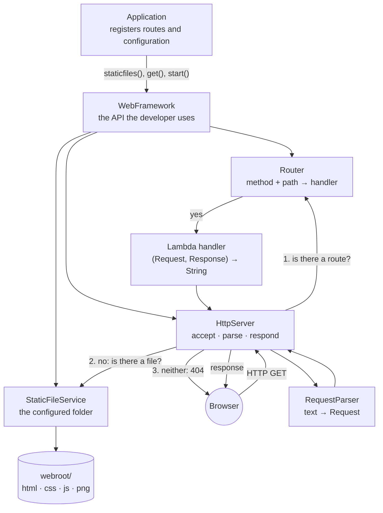

# Maintainable Application Server

A small Java **application server** — a lightweight web framework — in which a developer registers
HTTP services as lambda functions and points the framework at a folder of static resources, without
ever touching the code that accepts connections.

```java
import static co.edu.escuelaing.webframework.WebFramework.*;

public class Application {
    public static void main(String[] args) throws Exception {
        staticfiles("/webroot");

        get("/hello", (req, resp) -> "Hello " + req.getValueOrDefault("name", "world"));
        get("/pi", (req, resp) -> String.valueOf(Math.PI));

        start();
    }
}
```


> ### Public deployment
> **`http://<PUBLIC-DNS-OF-YOUR-INSTANCE>:8080/`**
>
> *Replace this line with the address of your running instance once you deploy it, following
> [docs/cloud-deployment.md](docs/cloud-deployment.md). The platform is **AWS EC2**, the
> application runs with `APP_ENV=production`, and `/shutdown` is therefore not published there.*

---

## What problem it solves

In the previous laboratory every dynamic route was a condition inside the loop that reads sockets:

```java
if (path.equals("/hello")) {
    // dynamic behaviour
} else {
    // static file behaviour
}
```

That works for two routes and becomes unreadable at twenty: the file that knows about TCP, HTTP
parsing and byte counting also has to know about every business rule of the application, so every
new service is a change to the most delicate code in the project.

This laboratory separates the part that never changes (accepting a connection, parsing a request,
writing a response) from the part that changes every week (which services exist and what they
answer). The server becomes infrastructure; the application becomes a list of registrations.

The server remains **sequential** on purpose: one connection is served completely before the next
one is accepted. Threads, pools and asynchronous request handling belong to the next laboratory.

---

## System metaphor: an office building

> **The framework is an office building, and the application is the list of offices inside it.**

| In the building | In the framework | What it does |
| --- | --- | --- |
| The entrance and its receptionist | `HttpServer` | Lets one visitor in at a time, listens to what they ask and hands back the answer. Never decides the content of the answer. |
| The directory in the lobby | `Router` | Reads the name the visitor asked for and says which office handles it. Adding an office means adding a line to the directory, not rebuilding the entrance. |
| The individual offices | Lambda handlers (`RouteHandler`) | Each one does a single job and knows nothing about doors, queues or the building's plumbing. |
| The visitor's request form | `Request` | The question as the office receives it, already filled in: the path, and the values the visitor wrote in the query string. |
| The answer sheet | `Response` | Where an office can stamp a different status or say that its answer is JSON rather than plain text. |
| The document archive | `StaticFileService` | When the visitor asks for a document rather than for a service, the archive hands over the HTML page, the style sheet, the script or an image. |
| The building's settings | Environment variables | Which door number the building uses (`PORT`), whether it is the real headquarters or a rehearsal (`APP_ENV`), how the receptionist greets people (`GREETING_PREFIX`). Changing them does not touch the building. |
| The closing procedure | Graceful shutdown | When the closing order arrives, the receptionist finishes attending the visitor already at the desk, shows them out, and only then locks the front door. |

The metaphor holds where it matters: a visitor who asks for an office that does not exist is told
so politely (`404`) instead of the building collapsing, and a new office opens by adding a line to
the directory — the entrance, the receptionist and the archive are untouched.

---

## Architecture



Route resolution, in the order the server applies it:

```text
Incoming request
        ↓
Parse method, path and query string          RequestParser
        ↓
Is a route registered for that method+path?  Router
        ↓ yes                    ↓ no
Run the lambda            Is there a file in the static folder?   StaticFileService
        ↓                        ↓ yes                ↓ no
   Its return value        The file's bytes      404 Not Found
```

### Responsibilities of each component

| Component | Responsibility | What it does **not** do |
| --- | --- | --- |
| `WebFramework` | The public API: `staticfiles()`, `get()`, `start()`, `stop()`. Resolves `PORT` and `STATIC_FILES_PATH` from the environment. | Parse HTTP, touch sockets or implement services. |
| `Router` | Holds the table of registered routes and resolves a method and path to a handler. | Know what a socket or a response is. |
| `Route` | One registration: method, path and handler, with the path normalised. | Decide anything at request time. |
| `RouteHandler` | The functional interface every service implements — what makes a route a lambda. | Anything else; it has a single method. |
| `Request` | The request as the application sees it: path, headers and decoded query values via `getValue()`. | Read from the network. |
| `Response` | Status, content type and headers a handler may change. | Write to the network. |
| `RequestParser` | Turns the bytes of a request into a `Request`, rejecting malformed input. | Decide which service answers. |
| `HttpServer` | Accepts connections one at a time, asks the router and then the static service, writes the response, and ends its loop when asked to stop. | Contain any application rule. |
| `StaticFileService` | Finds a file in the configured folder, as bytes, with its content type, refusing unsafe paths. | Serve dynamic content. |
| `MediaTypes` / `ResourcePaths` | Extension to content type; path normalisation and traversal refusal. | — |
| `Application` | Declares the static folder and the services. This is the only file that changes when the application grows. | Know anything about HTTP mechanics. |

### Project structure

```text
src/main/java/
├── co/edu/escuelaing/webframework/      the framework
│   ├── WebFramework.java                staticfiles(), get(), start(), stop()
│   ├── Router.java, Route.java          the routing table
│   ├── RouteHandler.java                the functional interface of a service
│   ├── Request.java, Response.java      the HTTP abstractions
│   ├── RequestParser.java               text → Request
│   ├── HttpServer.java                  the sequential accept loop
│   ├── StaticFileService.java           the static folder
│   ├── StaticFile.java, MediaTypes.java, ResourcePaths.java
│   └── MalformedRequestException.java
└── co/edu/escuelaing/app/
    └── Application.java                 the example application

src/main/resources/webroot/              the static resources
├── index.html, styles.css, app.js
└── images/logo.png, images/favicon.png

src/test/java/co/edu/escuelaing/webframework/   45 tests, separate from the application

scripts/                                 build, upload, install, verify
docs/                                    cloud deployment and evidence
```

---

## Prerequisites

| Tool | Version | Notes |
| --- | --- | --- |
| JDK | 17 or newer | developed and tested with OpenJDK 21 |
| Apache Maven | 3.8 or newer, optional | the bundled wrapper works with only a JDK |
| curl | optional | used by `scripts/smoke-test.sh` |

The framework has **no runtime dependency**; JUnit 5 is used only by the tests.

## Build and run locally

```bash
git clone https://github.com/SoullessSapo/Minimal-HTTP-Server-to-a-Web-Application-on-AWS.git
cd Minimal-HTTP-Server-to-a-Web-Application-on-AWS
git checkout lab-application-server

./mvnw -B clean package        # Linux and macOS   (or mvn -B clean package)
.\mvnw.cmd -B clean package    # Windows PowerShell

java -jar target/application-server.jar
```

Then open <http://localhost:8080/>. Stop it with `Ctrl+C`, or with the shutdown route:

```bash
curl http://localhost:8080/shutdown
```

Running on another port, with another greeting, as if it were the cloud:

```bash
PORT=9090 APP_ENV=production GREETING_PREFIX=Hola java -jar target/application-server.jar
```

## Environment variables

Nothing that depends on the deployment is written in the source code.

| Variable | Purpose | Local default | Read by |
| --- | --- | --- | --- |
| `PORT` | TCP port the server binds. The cloud platform imposes it. | `8080` | `WebFramework.start()` |
| `APP_ENV` | Execution environment. Only `development` publishes the `/shutdown` route. | `development` | `Application` |
| `GREETING_PREFIX` | Non-sensitive text used by the greeting service. | `Hello` | `Application` |
| `STATIC_FILES_PATH` | Optional folder on disk whose files take precedence over the packaged ones. | *(none)* | `WebFramework.start()` |

An unreadable `PORT` falls back to the default with a message instead of preventing the
application from starting. **No credential, token or key is read, printed or committed.**

## How to use the application

| Action on the page | Request | Answer |
| --- | --- | --- |
| Type a name, *Say hello* | `GET /hello?name=Pedro` | `Hello Pedro` — the prefix comes from `GREETING_PREFIX` |
| Type a number, *Calculate* | `GET /square?value=7` | `7 squared is 49`; a missing or invalid value answers `400` |
| *Ask for π* | `GET /pi` | `3.141592653589793` |
| *Greeting as JSON* | `GET /greeting?name=Ana&language=es` | `{"greeting":"Hello Ana","language":"es"}` |
| *Show configuration* | `GET /config` | the non-sensitive configuration in use |
| *Request something that does not exist* | `GET /unknown` | `404 Not Found` |

Example URLs, local and in the cloud:

```text
# static resources
http://localhost:8080/                      http://<public-dns>:8080/
http://localhost:8080/styles.css            http://<public-dns>:8080/styles.css
http://localhost:8080/app.js                http://<public-dns>:8080/app.js
http://localhost:8080/images/logo.png       http://<public-dns>:8080/images/logo.png

# REST endpoints
http://localhost:8080/hello?name=Pedro      http://<public-dns>:8080/hello?name=Pedro
http://localhost:8080/pi                    http://<public-dns>:8080/pi
http://localhost:8080/square?value=7        http://<public-dns>:8080/square?value=7
http://localhost:8080/greeting?name=Ana&language=es
http://localhost:8080/config                http://<public-dns>:8080/config

# lifecycle: 200 locally in development, 404 in the cloud
http://localhost:8080/shutdown              http://<public-dns>:8080/shutdown
```

## Graceful shutdown

The application registers the route only in development:

```java
if ("development".equalsIgnoreCase(APP_ENV)) {
    get("/shutdown", (req, resp) -> {
        stop();
        return "Server will stop after this response.";
    });
}
```

`stop()` does not interrupt anything. It sets a flag that the loop reads **after** the current
exchange is finished, so the order is always: answer the request, close the client socket, leave
the loop, close the listening socket, print `Server stopped gracefully.` In production the route is
never registered, so the path simply does not exist and answers `404`.

## Cloud deployment

**Platform: AWS EC2.** One Linux instance, the jar under `/opt/application-server`, supervised by
systemd, with `PORT`, `APP_ENV=production` and `GREETING_PREFIX` as environment variables of the
service unit. The full procedure, the security-group rules, the verification and the mandatory
cleanup are in **[docs/cloud-deployment.md](docs/cloud-deployment.md)**.

```bash
export EC2_HOST=ec2-user@<public-dns>
export EC2_KEY=~/.ssh/your-lab-key.pem      # never stored in this repository
export APP_ENV=production
./scripts/deploy-to-ec2.sh
```

## Tests

```bash
./mvnw test                                        # 45 unit and integration tests
./scripts/smoke-test.sh                            # manual matrix against a running server
./scripts/smoke-test.sh http://<public-dns>:8080 disabled
```

The suite covers the routing table, the parser and its query values, the static folder and its
refusal of unsafe paths, the resolution of `PORT`, and — over real sockets — successful requests,
`404` for an unknown resource, `400` for a malformed request, `500` for a handler that throws, ten
consecutive requests in one run, and a shutdown route that is answered completely before the server
leaves its loop.

The results, the browser screenshots, the protocol traces and the evidence of `/shutdown` working
in development and being absent in production are collected in
**[docs/evidence.md](docs/evidence.md)**.

---

## Why this architecture is maintainable

| Principle | How it appears here |
| --- | --- |
| **Separation of concerns** | `HttpServer` knows about sockets and never about greetings; `Application` knows about greetings and never about sockets. |
| **Modularity** | Routing, parsing, static files and services are four components that can be read, tested and replaced on their own. |
| **Low coupling** | Adding `/square` did not change one line of the server, the parser or the router. |
| **High cohesion** | Each class has one reason to change: the parser when the wire format changes, the router when matching rules change. |
| **Abstraction** | The application uses `get()` and `staticfiles()`; it never sees a `ServerSocket`. |
| **Externalised configuration** | Port, environment and greeting come from variables, so the same artifact runs locally and in the cloud. |
| **Extensibility** | A new service is a new registration; nothing existing is edited. |
| **Testability** | The router and the parser are tested without a network; the server is tested on an ephemeral port. |
| **Operational maintainability** | One jar, started the same way everywhere, with a shutdown that finishes the request in flight. |

The transformation, in one picture:

```text
Before                                  After
HTTP Server                             HTTP Server → Router → lambda handlers
 ├── socket management                   │                      ├── /hello
 ├── HTTP parsing                        │                      ├── /pi
 ├── static files                        │                      └── future services
 ├── /hello implementation               │
 ├── /pi implementation                  └── Static File Service
 └── every future route
```

## Verification checklist

| Requirement | Status |
| --- | --- |
| The project builds with Maven | ✅ `mvn clean package` |
| HTML, CSS, JavaScript and an image are served | ✅ evidence §1 |
| At least two GET lambda routes work locally | ✅ five routes, evidence §2 and §5 |
| Query values can be read from the request | ✅ `getValue()`, evidence §5 |
| Unknown resources return 404 | ✅ evidence §4 and §5 |
| `PORT` is read from the environment | ✅ `WebFramework.start()`, tested |
| At least one additional environment variable | ✅ `APP_ENV`, `GREETING_PREFIX`, `STATIC_FILES_PATH` |
| `/shutdown` stops the local server gracefully | ✅ evidence §6 |
| The server remains sequential | ✅ one accept loop, no thread or executor |
| Deployed publicly to the cloud | ⏳ pending — fill in the URL above |
| The deployment uses `APP_ENV=production` | ✅ configured by the installer |
| Production does not expose `/shutdown` | ✅ evidence §7, verified locally with `APP_ENV=production` |
| README with evidence, architecture and metaphor | ✅ this file |

## Author and acknowledgments

**Esteban Valencia** — Escuela Colombiana de Ingeniería Julio Garavito.

- The course laboratory guide *Building and Deploying a Maintainable Application Server*, which
  defines the required API, the constraints and the deliverables.
- [RFC 9110](https://www.rfc-editor.org/rfc/rfc9110.html) and
  [RFC 9112](https://www.rfc-editor.org/rfc/rfc9112.html) for HTTP semantics and message format.
- [MDN Web Docs](https://developer.mozilla.org/) for `fetch` and MIME types.
- The [Java SE 17 API documentation](https://docs.oracle.com/en/java/javase/17/docs/api/) for
  `java.net.ServerSocket`, `java.net.URLDecoder` and `java.nio.file`.
- The AWS documentation referenced at the end of
  [docs/cloud-deployment.md](docs/cloud-deployment.md).
- Built with [Apache Maven](https://maven.apache.org/) and [JUnit 5](https://junit.org/junit5/).
- Development assistance: the code, tests and documentation were written by the author with the
  help of Claude Code, and every behaviour described here was executed and verified.
