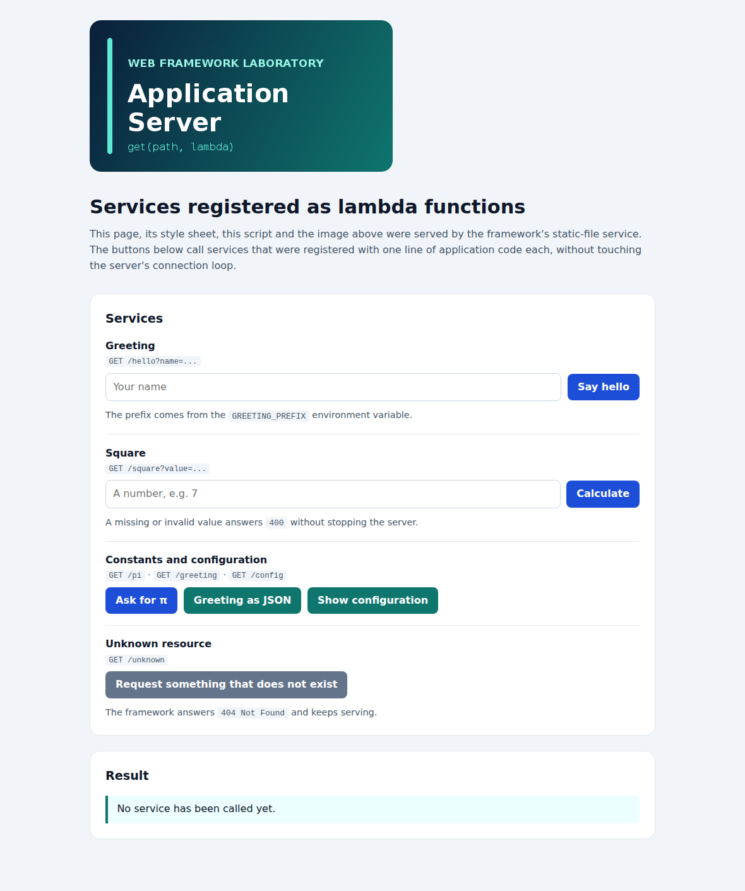
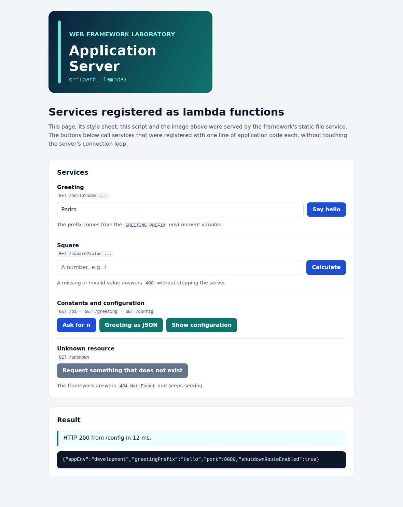
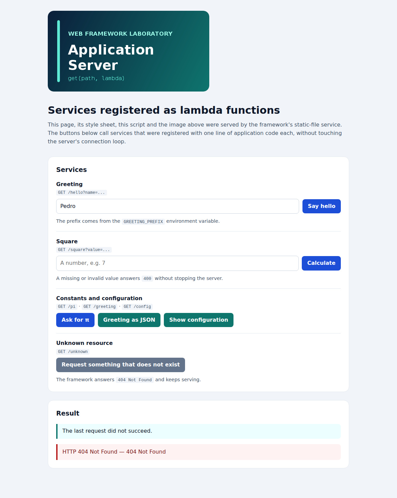

# Evidence and tests

Everything on this page was produced by running the application with
`java -jar target/application-server.jar`. The screenshots were taken in a real Chromium browser.
The last section is reserved for the cloud deployment, which has to be captured on your own
account.

---

## 1. The page and its static resources



Loading the page produced one request per resource, each with its own content type — the proof
that the static-file service works for text and for binary content alike:

| Method | Path | Status | Content type | Length |
| --- | --- | --- | --- | --- |
| GET | `/` | 200 | `text/html; charset=UTF-8` | 2931 |
| GET | `/styles.css` | 200 | `text/css; charset=UTF-8` | 2559 |
| GET | `/app.js` | 200 | `text/javascript; charset=UTF-8` | 3462 |
| GET | `/images/logo.png` | 200 | `image/png` | 32116 |

The raw capture is in [`img/network.json`](img/network.json).

---

## 2. Lambda services called from the browser

The greeting service, reached with `fetch()` — the page was never reloaded:


A second service, registered with a single line of application code:


---

## 3. Configuration read from the environment



The `/config` service reports the values actually in use. They are all non-sensitive by design:
no credential, token or key is ever exposed by this route.

---

## 4. An unknown resource returns 404 and the server keeps serving



---

## 5. Protocol evidence

### Two REST endpoints

```http
$ curl -i http://localhost:8080/hello?name=Pedro
HTTP/1.1 200 OK
Server: webframework/1.0
Content-Type: text/plain; charset=UTF-8
Content-Length: 11
Connection: close

Hello Pedro
```

```http
$ curl -i http://localhost:8080/pi
HTTP/1.1 200 OK
Server: webframework/1.0
Content-Type: text/plain; charset=UTF-8
Content-Length: 17
Connection: close

3.141592653589793
```

### Two query parameters in one request

```http
$ curl -i "http://localhost:8080/greeting?name=Ana&language=es"
HTTP/1.1 200 OK
Content-Type: application/json; charset=UTF-8
Content-Length: 40

{"greeting":"Hello Ana","language":"es"}
```

### A static binary resource

```http
$ curl -I http://localhost:8080/images/logo.png
HTTP/1.1 200 OK
Content-Type: image/png
Content-Length: 32116
Connection: close
```

### Errors that do not stop the server

```http
$ curl -i http://localhost:8080/unknown
HTTP/1.1 404 Not Found
Content-Type: text/plain; charset=UTF-8
Content-Length: 13

404 Not Found
```

```http
$ curl -i http://localhost:8080/square
HTTP/1.1 400 Bad Request
Content-Type: text/plain; charset=UTF-8
Content-Length: 68

The query parameter 'value' is required, for example /square?value=7
```

```text
$ printf 'THIS IS NOT HTTP\r\n\r\n' | nc localhost 8080
HTTP/1.1 400 Bad Request
Content-Type: text/plain; charset=UTF-8

400 Bad Request: Unexpected request line: THIS IS NOT HTTP
```

After each of those, the next request is answered normally: the listening socket stayed open.

---

## 6. Graceful shutdown in development

```console
$ curl -i http://localhost:8080/shutdown
HTTP/1.1 200 OK
Server: webframework/1.0
Content-Type: text/plain; charset=UTF-8
Content-Length: 37
Connection: close

Server will stop after this response.

$ curl -sS http://localhost:8080/pi
curl: (7) Failed to connect to localhost port 8080 after 0 ms: Couldn't connect to server
```

The server's own log shows the order in which it happened — the response is written first and the
loop ends afterwards:

```text
GET /unknown -> 404 text/plain; charset=UTF-8 (13 bytes)
GET /square -> 400 text/plain; charset=UTF-8 (68 bytes)
GET /shutdown -> 200 text/plain; charset=UTF-8 (37 bytes)
Server stopped gracefully.
```

---

## 7. The shutdown route does not exist in production

```console
$ PORT=9090 APP_ENV=production GREETING_PREFIX=Hola java -jar target/application-server.jar
APP_ENV=production: the /shutdown route is NOT published.
Registered routes: [GET /hello, GET /pi, GET /square, GET /greeting, GET /config]
Server listening on port 9090

$ curl -i http://localhost:9090/shutdown
HTTP/1.1 404 Not Found
Content-Type: text/plain; charset=UTF-8
Content-Length: 13

404 Not Found

$ curl -s http://localhost:9090/pi        # the server is still running
3.141592653589793

$ curl -s "http://localhost:9090/hello?name=Esteban"
Hola Esteban

$ curl -s http://localhost:9090/config
{"appEnv":"production","greetingPrefix":"Hola","port":9090,"shutdownRouteEnabled":false}
```

Three externalised values are visible at once in that run: the port came from `PORT`, the greeting
prefix from `GREETING_PREFIX`, and `APP_ENV` decided that the lifecycle route is never registered.
The route is not merely hidden: it was never added to the routing table, so there is nothing to
reach.

---

## 8. Tests performed

### Automated suite

```text
$ mvn test
[INFO] Tests run: 9,  Failures: 0, Errors: 0, Skipped: 0 -- StaticFileServiceTest
[INFO] Tests run: 5,  Failures: 0, Errors: 0, Skipped: 0 -- WebFrameworkTest
[INFO] Tests run: 14, Failures: 0, Errors: 0, Skipped: 0 -- HttpServerIntegrationTest
[INFO] Tests run: 7,  Failures: 0, Errors: 0, Skipped: 0 -- RouterTest
[INFO] Tests run: 10, Failures: 0, Errors: 0, Skipped: 0 -- RequestParserTest
[INFO] Tests run: 45, Failures: 0, Errors: 0, Skipped: 0
[INFO] BUILD SUCCESS
```

### Manual matrix (`scripts/smoke-test.sh`)

```text
Checking http://localhost:8080

Static resources
  ok    home page                  /                                  200 text/html; charset=UTF-8
  ok    style sheet                /styles.css                        200 text/css; charset=UTF-8
  ok    client script              /app.js                            200 text/javascript; charset=UTF-8
  ok    image                      /images/logo.png                   200 image/png

Lambda services
  ok    greeting                   /hello?name=Pedro                  200 text/plain; charset=UTF-8
  ok    pi                         /pi                                200 text/plain; charset=UTF-8
  ok    square                     /square?value=7                    200 text/plain; charset=UTF-8
  ok    greeting as JSON           /greeting?name=Ana&language=es     200 application/json; charset=UTF-8
  ok    configuration              /config                            200 application/json; charset=UTF-8

Query-string values
  ok    name is read               /hello?name=Pedro                  Hello Pedro
  ok    missing name               /hello                             Hello world
  ok    two parameters             /greeting?name=Ana&language=es     {"greeting":"Hello Ana","language":"es"}
  ok    square of 7                /square?value=7                    7 squared is 49

Errors that must not stop the server
  ok    unknown route              /unknown                           404 text/plain; charset=UTF-8
  ok    missing file               /does-not-exist.html               404 text/plain; charset=UTF-8
  ok    invalid number             /square?value=abc                  400 text/plain; charset=UTF-8
  ok    missing parameter          /square                            400 text/plain; charset=UTF-8
  ok    still serving              /pi                                200 text/plain; charset=UTF-8

Lifecycle route
  ok       /shutdown is not published: 404 (production)

All checks passed.
```

---

## 9. Cloud deployment

> Capture this section on your own deployment, following
> [`cloud-deployment.md`](cloud-deployment.md). Publish the public address, never an account
> identifier, a key or any credential.

| Evidence | How to capture it | Status |
| --- | --- | --- |
| The page loaded from the public URL, with the address bar visible | browser | pending |
| One static resource served from the cloud (`/images/logo.png`) | browser or `curl -I` | pending |
| Two REST endpoints answering from the cloud (`/hello?name=...`, `/pi`) | browser network view or `curl -i` | pending |
| `/config` showing `APP_ENV=production` and the configured prefix | browser | pending |
| `/shutdown` answering 404 on the public URL | `curl -i http://<public-url>/shutdown` | pending |
| The environment variables of the service, without secrets | `systemctl show application-server -p Environment` | pending |
| `./scripts/smoke-test.sh http://<public-url> disabled` | your computer | pending |
